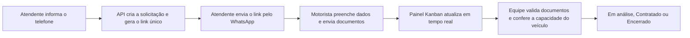
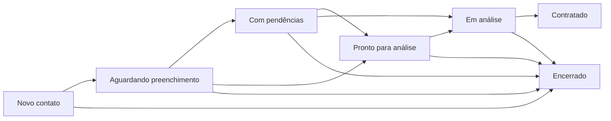
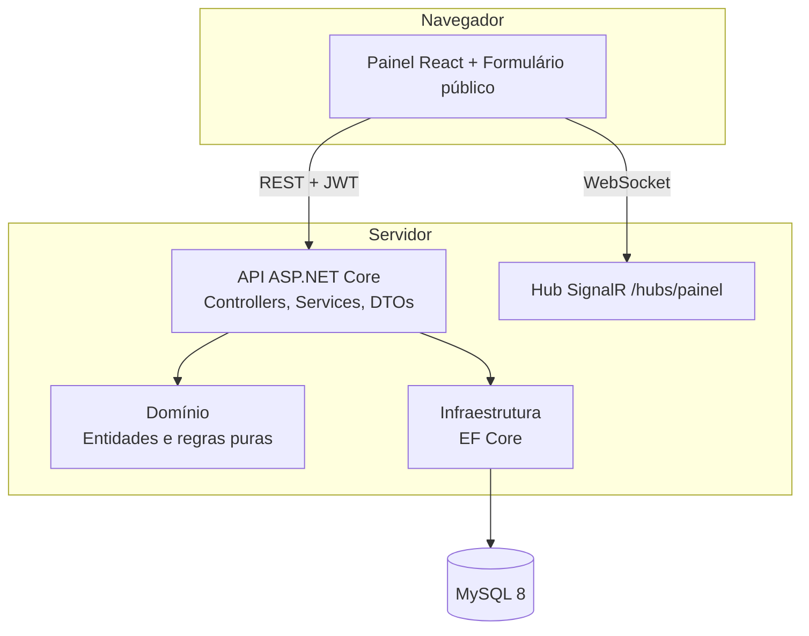

# Sistema de Gestão de Captação e Atendimento de Caminhoneiros


Plataforma web para organizar a captação de motoristas autônomos de carga. A equipe inicia um atendimento a partir do telefone do motorista, o motorista preenche o cadastro e envia os documentos por um link seguro, e a equipe acompanha tudo em um painel Kanban com atualização em tempo real, até a contratação.

Projeto de Trabalho de Conclusão de Curso, **FATEC Araraquara**, por **Gabriel Braga** e **Vitor Matos**.

> Para instalar e executar em outro computador, siga o [COMO-RODAR.md](COMO-RODAR.md).

---

## Sumário

- [O problema](#o-problema)
- [Como funciona](#como-funciona)
- [Funcionalidades](#funcionalidades)
- [Regras de negócio](#regras-de-negócio)
- [Arquitetura](#arquitetura)
- [Tecnologias](#tecnologias)
- [Estrutura do repositório](#estrutura-do-repositório)
- [Executando o projeto](#executando-o-projeto)
- [API](#api)
- [Segurança](#segurança)
- [Testes](#testes)
- [Fora do escopo e trabalhos futuros](#fora-do-escopo-e-trabalhos-futuros)
- [Autores](#autores)

---

## O problema

A captação de caminhoneiros costuma acontecer em conversas soltas de WhatsApp. Os dados chegam incompletos, os documentos se perdem, ninguém sabe em que etapa cada motorista está e não há como saber se o veículo comporta a carga. O resultado é retrabalho, demora na contratação e nenhuma visão de conjunto.

Este sistema centraliza o processo: cada contato vira uma **solicitação** com status, prioridade e histórico, e os dados e documentos ficam vinculados ao motorista.

## Como funciona



O envio da mensagem pelo WhatsApp é **semi-manual**: o sistema gera o link e a mensagem sugerida, e o atendente envia pelo botão "Enviar pelo WhatsApp".

<!--
## Capturas de tela

Adicione as imagens em docs/img/ e remova os comentários desta seção.

| Login | Painel Kanban |
|---|---|
|  |  |

| Formulário do motorista | Relatórios |
|---|---|
|  |  |
-->

## Funcionalidades

**Para a equipe (painel administrativo)**

- Login com perfis **Administrador** e **Atendente**.
- **Central de atendimento** em Kanban, com filtros por status e prioridade e atualização em tempo real via SignalR.
- **Iniciar atendimento** pelo telefone: localiza ou cria o motorista, abre a solicitação e gera o link com a mensagem pronta.
- **Detalhe da solicitação**: dados do motorista, CPF mascarado, veículo, carga vinculada, compatibilidade de capacidade, atendente responsável, validação e download dos documentos.
- **Motoristas**: lista com busca por nome, telefone ou placa, ficha completa e histórico de solicitações.
- **Cargas**: cadastro com origem, destino e capacidade mínima, e controle de disponibilidade.
- **Formulário e documentos**: o administrador define quais campos e documentos são exigidos e se são obrigatórios.
- **Equipe e acessos**: cadastro, edição, desativação e reativação de usuários.
- **Relatórios**: indicadores do funil, taxa de conversão, tempo médio de atendimento e exportação em CSV, com filtro por período.

**Para o motorista (formulário público)**

- Acesso por link único, sem criar conta, em 3 etapas: dados pessoais, veículo e documentos.
- Envio de CNH, CRLV, comprovante de RNTRC e documento adicional da carga (PDF, JPG ou PNG, até 10 MB).
- Reaproveitamento de veículos já cadastrados e retorno claro sobre pendências.

## Regras de negócio

### Status da solicitação



- **Automáticos:** Novo contato, Aguardando preenchimento, Com pendências e Pronto para análise. A API define conforme o formulário e os documentos.
- **Manuais:** Em análise, Contratado e Encerrado, definidos pela equipe.
- **Em análise** só vem de *Com pendências* ou *Pronto para análise*. **Contratado** só vem de *Em análise*. **Encerrado** vale para qualquer solicitação não finalizada.
- Para marcar uma solicitação como **Contratado**, todos os campos obrigatórios precisam estar preenchidos e todos os documentos obrigatórios validados. Documentos opcionais não bloqueiam a contratação.

### Prioridade

| Prioridade | Quando |
|---|---|
| **Alta** | Tudo preenchido, documentos obrigatórios validados e veículo compatível (quando há carga). |
| **Média** | Formulário enviado, mas há documento obrigatório ausente ou aguardando validação, ou a compatibilidade ainda não pôde ser verificada. |
| **Baixa** | Etapa inicial, formulário incompleto, documento reprovado ou veículo incompatível. |

### Compatibilidade de capacidade

Compara a capacidade do veículo (toneladas) com a capacidade mínima exigida pela carga. O resultado pode ser: **Compatível**, **Incompatível**, **Não verificada**, **Sem restrição** ou **Não aplicável** (sem carga vinculada).

## Arquitetura



A solução separa responsabilidades em quatro projetos:

| Projeto | Responsabilidade |
|---|---|
| `Captacao.Api` | Controllers, serviços de aplicação, DTOs, autenticação, hub SignalR e configuração. |
| `Captacao.Domain` | Entidades, constantes e **regras puras** (status, prioridade, compatibilidade, indicadores), sem dependência de banco ou web. |
| `Captacao.Infrastructure` | Contexto do Entity Framework Core e mapeamento para o MySQL. |
| `Captacao.Tests` | Testes automatizados com xUnit. |

O banco é criado pelo script SQL versionado em `database/criar_banco.sql` (10 tabelas, chaves estrangeiras com `ON DELETE RESTRICT` e índices únicos). A aplicação não cria nem altera o esquema sozinha.

## Tecnologias

| Camada | Tecnologias |
|---|---|
| Back-end | .NET 10, ASP.NET Core Web API, Entity Framework Core 10, SignalR, Swagger |
| Banco de dados | MySQL 8 |
| Front-end | React 18, Vite 5, React Router 6, cliente SignalR (`@microsoft/signalr`) |
| Autenticação | JWT (Bearer) com perfis |
| Testes | xUnit |

## Estrutura do repositório

```
.
├── database/
│   └── criar_banco.sql              script de criação do banco
├── backend/
│   ├── CodigoFonte/
│   │   ├── API/                     controllers, services, DTOs, Program.cs
│   │   ├── Dominio/                 entidades e regras de negócio
│   │   └── Infraestrutura/          DbContext (EF Core)
│   ├── Testes/Captacao.Testes/      testes xUnit
│   ├── configurar.ps1 / .sh         geram a configuração local
│   └── README.md                    detalhes da API e da segurança
├── frontend/
│   └── Prototipo/                   painel React + Vite
├── COMO-RODAR.md                    guia de instalação passo a passo
└── README.md
```

## Executando o projeto

Resumo (o guia completo, com solução de problemas, está em [COMO-RODAR.md](COMO-RODAR.md)):

**Requisitos:** Git, .NET SDK 10, MySQL 8 e Node.js LTS.

```bash
# 1. Clonar
git clone https://github.com/Nazz1n/Projeto-Tcc.git
cd Projeto-Tcc

# 2. Criar o banco: execute database/criar_banco.sql no MySQL Workbench

# 3. Gerar a configuração local (pede a senha do MySQL e os dados do administrador)
cd backend
.\configurar.ps1            # Windows (PowerShell)
# ./configurar.sh           # Linux ou macOS

# 4. Subir a API (terminal 1)
cd CodigoFonte/API
dotnet run --launch-profile https

# 5. Subir o painel (terminal 2, a partir da raiz do projeto)
cd frontend/Prototipo
npm ci
npm run dev
```

- Painel: http://localhost:5173
- API: https://localhost:7033
- Documentação interativa (Swagger): https://localhost:7033/swagger

O painel e a API precisam rodar na mesma máquina, porque o front acessa a API por `localhost` através do proxy do Vite.

## API

Todas as rotas exigem JWT, exceto login e o formulário público. Visão geral:

| Recurso | Rotas principais | Acesso |
|---|---|---|
| Autenticação | `POST /api/Autenticacao/login` | Público |
| Atendimentos | `POST /api/Atendimentos/iniciar` | Equipe |
| Solicitações | `GET /api/Solicitacoes/kanban`, `GET /{id}`, `PATCH /{id}/status`, `/atendente`, `/carga`, `GET /{id}/historico` | Equipe |
| Motoristas | `GET /api/Motoristas?busca=`, `GET /{id}`, `POST` | Equipe |
| Veículos | `GET`, `POST`, `PUT`, `PATCH /{id}/status` | Equipe |
| Cargas | `GET`, `POST`, `PUT`, `PATCH /{id}/status` | Leitura: equipe. Escrita: Administrador |
| Documentos | `GET /{id}/arquivo`, `PATCH /{id}/validacao` | Equipe |
| Formulário público | `GET /api/Formulario`, `PUT /dados`, `POST /documentos`, `POST /enviar` (cabeçalho `X-Token-Acesso`) | Link de acesso |
| Campos do formulário | `GET`, `PUT /{id}`, `PATCH /{id}/ativar` e `/desativar` | Administrador |
| Atendentes | `GET`, `POST`, `PUT /{id}`, `PATCH /{id}/inativar` e `/reativar` | Administrador (`GET /ativos`: equipe) |
| Relatórios | `GET /api/Relatorios/indicadores`, `GET /solicitacoes/exportar` | Administrador |
| Auditoria | `GET /api/Auditoria` | Administrador |
| Tempo real | Hub `/hubs/painel`: eventos `SolicitacaoAtualizada` e `SolicitacaoProntaParaAnalise` | Equipe |

A referência completa e testável está no Swagger.

## Segurança

- **Autenticação e perfis:** JWT com expiração de 60 minutos e autorização por perfil (Administrador e Atendente). Qualquer rota sem política explícita exige usuário autenticado.
- **Senhas:** armazenadas apenas como hash.
- **CPF protegido:** guardado cifrado (ASP.NET Data Protection) e com um hash HMAC-SHA256 para busca e verificação de duplicidade. Nas telas aparece sempre mascarado.
- **Links de acesso:** token de 256 bits gerado aleatoriamente, armazenado apenas como hash SHA-256, de uso único e com validade de 24 horas.
- **Upload de documentos:** somente PDF, JPG e PNG, com limite de 10 MB e validação no servidor. Os arquivos ficam fora do código versionado e só são baixados por usuários autenticados.
- **Limitação de requisições:** 10 por minuto no login e 60 por minuto no formulário público.
- **Auditoria:** exportações, mudanças de configuração e atribuições ficam registradas.
- **Segredos fora do Git:** `appsettings.Development.json`, `.env` e a pasta `dados-seguranca/` são ignorados. Cada máquina gera a própria configuração com o script `configurar`.

## Testes

```bash
dotnet test backend/Testes/Captacao.Testes/Captacao.Tests.csproj
```

Os testes cobrem as regras de domínio (status, prioridade, compatibilidade, indicadores, formatação de telefone e CPF) e a proteção do CPF. Para o front-end, valide a compilação com:

```bash
cd frontend/Prototipo
npm run build
```

## Fora do escopo e trabalhos futuros

- Automação do envio de mensagens pelo WhatsApp (hoje o envio é semi-manual).
- Telas de auditoria, histórico de status e gestão de veículos no painel (os endpoints já existem na API).
- Armazenamento dos documentos em serviço externo. Hoje eles ficam em disco local, na pasta `dados-seguranca/` (configurável em `Armazenamento:PastaDocumentos`), que não é versionada.
- Implantação em ambiente de produção com HTTPS e domínio próprio.

## Autores

Trabalho de Conclusão de Curso, FATEC Araraquara.

**Gabriel Braga**
**Vitor Matos**